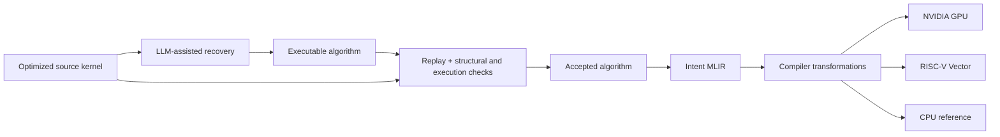
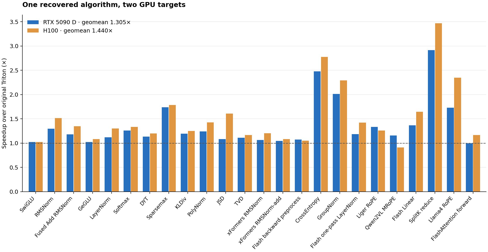

# IntentLift

### Recovering reusable algorithms from optimized kernels

IntentLift turns kernel migration into a compiler workflow. It recovers an executable, target-independent algorithm from optimized source code, checks that recovery, and hands the accepted representation to an MLIR compiler for target implementation and optimization.

The reusable object is the **algorithm and its semantic boundaries**: iteration, carried state, combination rules, valid domains, and observable effects. Target tiling, vectorization, and memory organization are chosen downstream. This separates the model's understanding of the source from the compiler's implementation of the accepted algorithm.

[Quick start](#quick-start) · [Architecture](docs/architecture.md) · [Running recovery](docs/workflows.md) · [Paper results](paper/README.md) · [Source provenance](docs/provenance.md)



## What is included

- **Recovery and checking:** source adapters, typed algorithm records, source-isolated Replay, compiler-observation comparison (Gate 1), and execution comparison (Gate 2).
- **Intent MLIR compiler:** the `intent` dialect, deterministic materialization from the algorithm, structural transformations, and CUDA / RISC-V Vector (RVV) target paths.
- **A runnable saved example:** compile the recovered SwiGLU algorithm through Intent MLIR and LLVM, then compare native CPU execution with its mathematical expression. No model credentials or GPU are needed for this example.
- **Paper results:** frozen CSV inputs, a reproducible summary plot, and provenance hashes. These are the existing paper measurements, not a new benchmark run of this checkout.

The project is named **IntentLift**; `intentir` remains the Python import namespace, and **Intent MLIR** names the compiler representation. This repository contains our dialect and passes, not a vendored copy of LLVM/MLIR.

## Quick start

Use Linux, Python 3.10+, CMake, Ninja, and LLVM/MLIR **20.1.8** with development headers, tools, Clang, and `libmlir_c_runner_utils.so`.

```bash
git clone https://github.com/Tianchen-ai/IntentLift.git
cd IntentLift
python3 -m venv .venv
source .venv/bin/activate
python -m pip install -e '.[verify]'

cmake -S . -B build -G Ninja \
  -DMLIR_DIR=/usr/lib/llvm-20/lib/cmake/mlir \
  -DLLVM_DIR=/usr/lib/llvm-20/lib/cmake/llvm \
  -DCMAKE_BUILD_TYPE=Release \
  -DCMAKE_C_COMPILER=clang-20 \
  -DCMAKE_CXX_COMPILER=clang++-20
cmake --build build --target intent-opt -j 6

python examples/swiglu/run.py
```

The example writes `output/swiglu/intent.mlir`, runs the native CPU implementation, and prints the numerical comparison result. See [the example](examples/swiglu/README.md) for its source and saved acceptance record, and [build instructions](docs/build-and-run.md) for custom toolchain paths.

## Selected paper results

| Evaluation | Result | Comparison / scope |
| --- | ---: | --- |
| RTX 5090 D | **1.305×** | Geometric-mean speedup over original Triton, 24 kernels |
| H100 80GB | **1.440×** | Geometric-mean speedup over original Triton, the same 24 kernels |
| SG2044 RVV attention forward | **3.104×** | Structural optimization over schedule search, one specified workload |
| SG2044 RVV attention forward | **3.585×** | Speedup over the LLVM RVV C baseline on that workload |
| Algorithm-mutation study | **250 / 250** | Activated mutations rejected by the combined checks |
| Frontend extension | **112 vs. 1,243 SLoC** | Marginal code for 12 extension groups, at equal detection |



Speedup is **baseline latency / IntentLift latency**; larger is better. The [results guide](paper/README.md) gives the complete mutation-study counts, baseline definitions, workload limits, and the distinction between marginal and total implementation size. Exact CSV fields and published aggregate values are preserved.

## Repository map

| Path | Contents |
| --- | --- |
| [`include/Intent`](include/Intent), [`lib/Intent`](lib/Intent) | Intent dialect, operations, and lowering / optimization passes |
| [`lib/Target`](lib/Target) | Target-specific compiler support |
| [`python/intentir`](python/intentir) | Recovery, algorithm contracts, Gate 1 / Gate 2, and backend orchestration |
| [`tools`](tools) | Compiler driver and recovery / benchmark command-line entry points |
| [`examples/swiglu`](examples/swiglu) | Saved algorithm, acceptance summary, and native compilation example |
| [`paper`](paper) | Frozen result tables and plot regeneration |
| [`docs`](docs) | Architecture, setup, workflows, and provenance |
| [`spec/lowering`](spec/lowering) | Workload and measurement specifications |

## Using the research implementation

Start with the saved example to inspect the compiler handoff. Fresh recovery additionally requires a supported source framework, its compiler and execution environment, and model access. CUDA and RVV performance evaluation require the corresponding hardware and toolchains; the RVV platform in the paper is **SG2044**. [Workflows](docs/workflows.md) identifies the relevant entry points and external inputs.

This snapshot integrates the upstream implementation update and existing RVV optimizations. Its source-bound Replay configuration differs from the slot-only protocol used in the paper's original experiment; the [protocol mapping](docs/provenance.md#paper-protocol-and-current-implementation) explains the distinction. In both, target materialization starts from the algorithm rather than source code or a fresh model-generated implementation.

For questions or collaboration, open an issue. Third-party notices are retained in [NOTICE.md](NOTICE.md).
